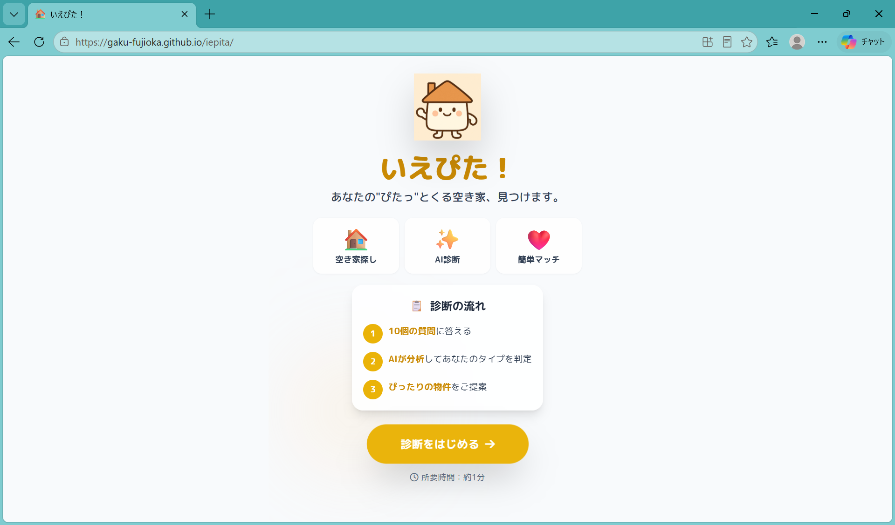
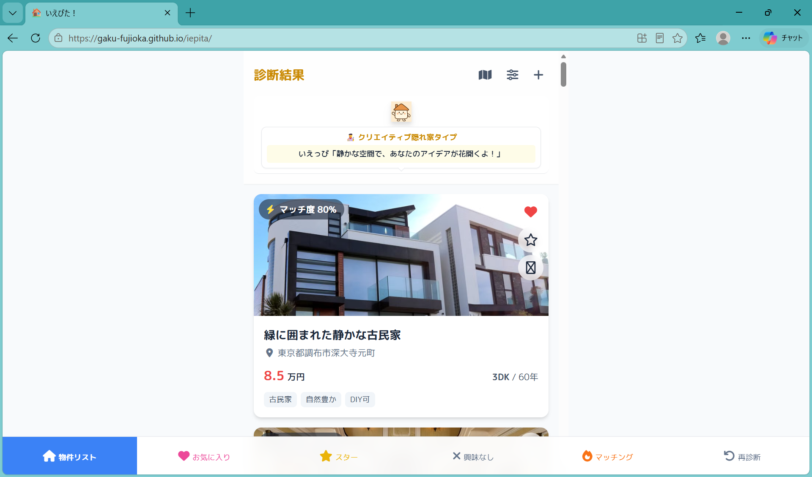
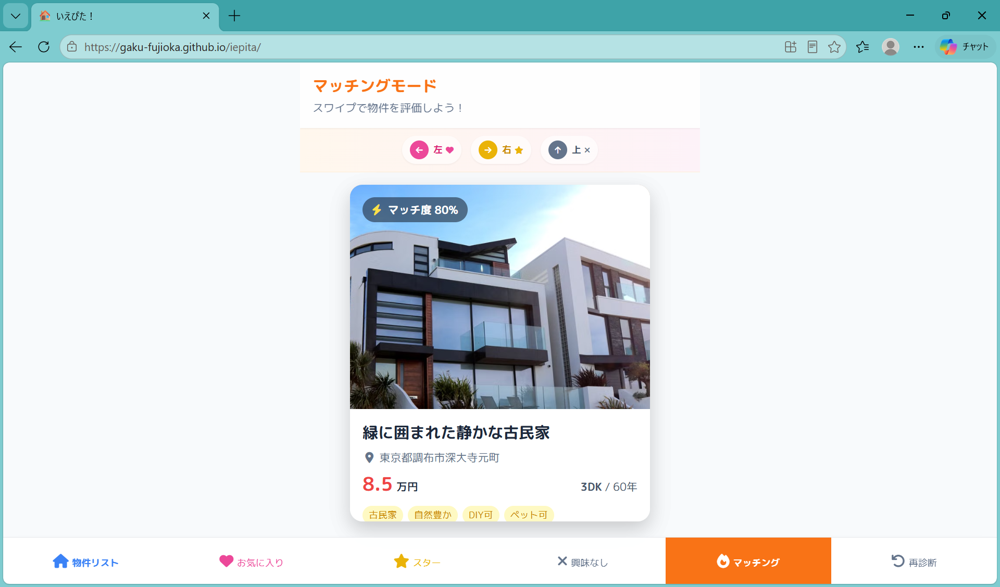
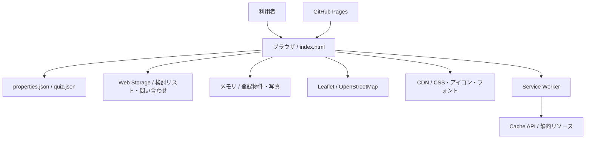

# いえぴた！

暮らし方の診断と直感的な物件探しで、自分にぴったりの住まいを見つけるWebアプリ。

## 🔗 Links

- Demo: [GitHub Pages](https://gaku-fujioka.github.io/iepita/)
- Repository: [Gaku-Fujioka/iepita](https://github.com/Gaku-Fujioka/iepita)

## 📸 Screenshots

### スタート画面

暮らし方診断の流れを確認し、10問の診断を開始できます。



### 診断結果・物件一覧

診断されたライフスタイルタイプと、マッチ度付きの物件候補を表示します。



### マッチングモード

物件カードをスワイプして、お気に入り・スター・興味なしに分類できます。



## 🎯 Overview

### 開発背景

J:COM主催の「2025年度 大学生と考えるSDGs アクション支援プロジェクト」への参加をきっかけに開発しました。

私たちは、空き家問題と、入居後に「住んでみたら、思っていた暮らしと違った」と感じる住まいのミスマッチに着目しました。空き家と人をつなぎ、ユーザーの好みや理想の暮らしに合う物件を家探しの最初の段階から提案できれば、空き家の活用と、納得できる住まい選びの両方につながると考えました。

この考えから、暮らし方の診断を通じて自分に合う空き家を探せるマッチングアプリ「いえぴた！」を制作しました。調布市の空き家探しをコンセプトに、自然のある暮らし、創作活動、地域との交流などの希望を物件選びにつなげます。

本プロジェクトは、同コンテストの**最終審査に進出**しました。

現在は、調布市・北海道・東北の物件を含む29件のサンプルデータで動作するプロトタイプです。

### 解決したい課題

- **空き家の活用**：空き家と、その物件に合う暮らしを求める人をつなぎ、空き家の削減につなげたい。
- **入居後のミスマッチ**：「住んでみたら、思っていた暮らしと違った」というギャップを減らしたい。
- **好みに合う家探し**：理想の暮らしを検索条件へ落とし込む難しさを解消し、最初から自分の好みに合う候補を探せるようにしたい。

## ✨ Features

- **暮らし方診断**：10問の回答から8種類のライフスタイルタイプを判定し、各物件のマッチ度を表示。
- **スワイプで物件選び**：左でお気に入り、右でスター、上で興味なしに分類。ボタンやマウス操作にも対応。
- **条件検索・並び替え**：都道府県・市区町村・賃料・築年数・タグで絞り込み。タグのAND／OR検索や、マッチ度・賃料・現在地からの距離による並び替えが可能。
- **地図・物件詳細**：物件の位置、マーカーのクラスタリング、現在地表示、内外観ギャラリー、共通タグに基づく類似物件を表示。
- **検討リストの保存**：お気に入り・スター・興味なしをブラウザに保存し、再訪時に復元。
- **会話形式の問い合わせ入力**：キャラクター「いえっぴ」の案内で問い合わせ内容や連絡先を入力し、ブラウザ内に保存。
- **物件登録のデモ**：物件情報の入力、写真の選択・プレビュー、一覧への追加に対応。
- **モバイル向けUI・PWA設定**：初回操作ガイド、効果音、対応端末での振動、Web App Manifest、Service Workerによる静的リソースのキャッシュを実装。

問い合わせの外部送信、物件登録のサーバー保存、ユーザー認証は未実装です。登録した物件と写真はメモリ上に保持され、ページの再読み込みで失われます。

## 🛠 Tech Stack

| 分類 | 技術 | 用途 |
|---|---|---|
| Frontend | HTML / CSS / JavaScript（Vanilla JS） | 画面構築、状態管理、診断・検索・スワイプ処理 |
| Frontend | Tailwind CSS（CDN） | レイアウト、装飾、レスポンシブ対応 |
| Frontend | Font Awesome 6.5.2 / Google Fonts | アイコン、日本語フォント |
| Map | Leaflet 1.9.4 / OpenStreetMap | 地図・物件位置の表示 |
| Map | Leaflet Locate Control 0.78.0 / MarkerCluster 1.4.1 | 現在地表示、マーカーの集約 |
| Backend | 未導入 | 現在はブラウザ内で処理を実行 |
| Database | JSONファイル / Web Storage | 物件・診断データ、検討リスト・問い合わせの保存 |
| Infrastructure | GitHub Pages / CDN | 静的サイトのホスティング、外部ライブラリの読み込み |
| PWA | Web App Manifest / Service Worker / Cache API | アプリ表示設定、静的リソースのキャッシュ |

## 🏗 Architecture

ビルド不要の静的Webアプリで、GitHub Pagesにデプロイしています。`index.html`にUI・スタイル・アプリケーションロジックをまとめ、物件情報と診断定義をJSONから読み込みます。



```text
iepita/
├── index.html              # UI・スタイル・アプリケーションロジック
├── properties.json         # 物件サンプルデータ（29件）
├── quiz.json               # 診断の質問・選択肢・タイプ別のタグ重み
├── manifest.json           # PWAの表示・起動設定
├── sw.js                   # キャッシュとオフライン時の処理
├── iepita.png              # キャラクター画像
├── docs/screenshots/       # README掲載用のスクリーンショット
├── sounds/                 # 操作・診断用の効果音
│   ├── README.md           # 効果音の設定ガイド
│   └── test-sounds.html    # 効果音の確認ページ
└── README.md
```

## 💡 Technical Highlights

### 1. タグを共通軸にした診断と物件のマッチング

- **課題**：暮らし方に関する回答を、物件のおすすめ順に反映する必要がある。
- **実装・設計**：回答の選択肢にタグを持たせ、タイプごとの`tagWeights`と照合して診断結果を決定。物件との共通タグ数・一致率に、お気に入りやスターなどの評価を加えてマッチ度を計算する。
- **結果**：診断の質問・タイプ・重みを`quiz.json`で管理し、画面のコードと分けて調整できる構成にした。

現在のマッチ度はルールベースの参考値で、計算時に±8点のランダム補正が入ります。同じ回答でも計算のたびに値が変わる場合があります。

### 2. スマートフォンで物件を選びやすくする操作設計

- **課題**：小さな画面でも、物件の確認と候補の分類を少ない操作で進められるようにする。
- **実装・設計**：タッチ・マウスによるカード操作、方向別のスワイプ判定、アニメーション中の操作制御を実装。効果音・対応端末での振動・トーストで操作結果を伝え、初回はスポットライト形式のガイドを表示する。
- **結果**：スワイプとボタンの両方から候補を分類できる。画面の高さは`window.innerHeight`からCSS変数へ反映し、下部ナビゲーションにはセーフエリアを考慮している。

## 👥 Development

- 開発人数：2人
- 開発期間：2025年9月中旬〜10月中旬（約1か月）
- 担当範囲：固定の役割分担は設けず、2人で開発全般に幅広く携わった。

## 📈 Future Improvements

以下は、現在の実装を踏まえた改善候補です。

- バックエンド・データベースを導入し、登録物件・写真・問い合わせを永続化する。
- ユーザー認証を追加し、検討リストを端末間で共有する。
- 実際の空き家情報や自治体データのAPIと連携する。
- マッチ度のランダム補正を見直し、おすすめ理由の表示と評価方法を整える。
- HTML・CSS・JavaScriptを分割し、診断や絞り込みなどの主要ロジックにテストを追加する。
- PWAの公開パス・アイコン・キャッシュ更新方法を整え、オフラインで利用できる範囲を広げる。
